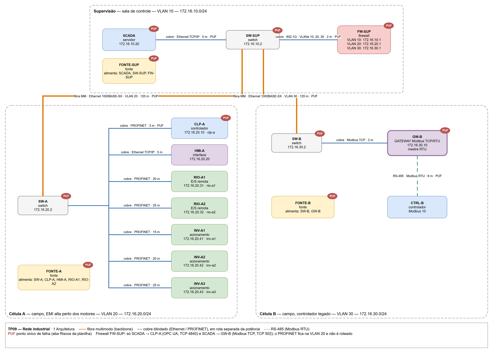
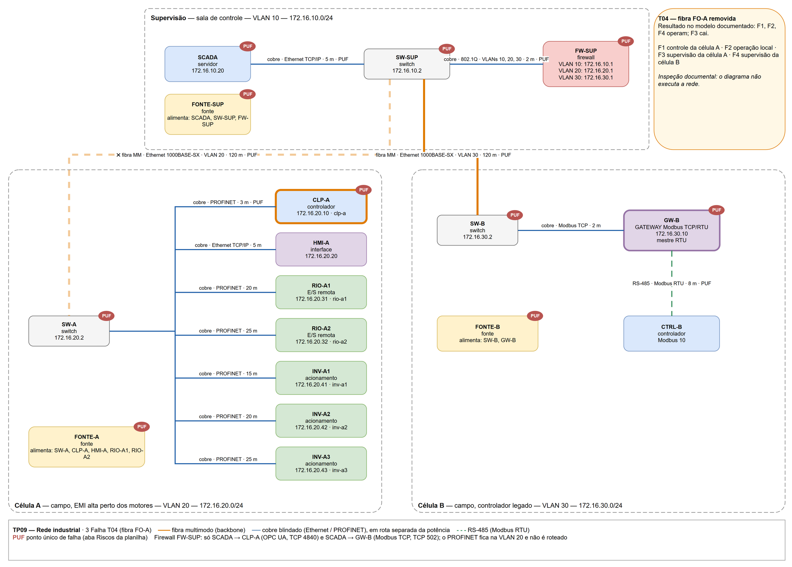

# TP09 — Redes industriais: projeto da rede de uma célula heterogênea

## Arquivos

- [`diagrama/rede.drawio`](diagrama/rede.drawio) — fonte editável no diagrams.net, com quatro páginas: arquitetura, falha T02, falha T04 e extensões; [`diagrama/rede.pdf`](diagrama/rede.pdf) — versão de leitura.
- [`planilha/TP09-rede.xlsx`](planilha/TP09-rede.xlsx) — abas **Nós**, **Enlaces**, **Matriz**, **Riscos**, **Testes** e **Ciclo Modbus**, importável no Google Planilhas. A coluna Situação da aba Nós marca endereço DUPLICADO por fórmula; a Matriz soma com `SUMPRODUCT`; o Ciclo Modbus calcula os tempos a partir das hipóteses.
- [`testes/casos_teste.csv`](testes/casos_teste.csv) — casos com estado inicial, estímulo, como observar, esperado, obtido e resultado; [`testes/resultados.json`](testes/resultados.json) — resultado da conferência, SHA-256 do diagrama e da planilha e auto-auditoria; [`testes/calculo-excel.json`](testes/calculo-excel.json) — valores calculados pelo próprio Excel (duplicidade, totais das matrizes e ciclo).
- [`evidencias/`](evidencias/) — páginas do diagrama (situação normal e de falha) e abas da planilha.

## Cenário e requisitos dominantes

Célula A com CLP, HMI, duas remotas e três inversores; célula B com um controlador legado que só fala Modbus RTU; servidor de supervisão na sala de controle, a 120 m das células; interferência eletromagnética alta perto dos motores; parada de até 15 min aceitável; quatro nós novos no próximo semestre.

| # | Requisito | Consequência no projeto |
|---|---|---|
| R1 | E/S e inversores com atualização cíclica e diagnóstico | PROFINET na célula A, em estrela |
| R2 | integrar o legado sem trocá-lo | gateway Modbus TCP/RTU na célula B |
| R3 | 120 m com EMI | fibra multimodo entre a sala e cada célula |
| R4 | falhas contidas por célula e fluxos controlados | uma VLAN e uma sub-rede por zona; firewall entre elas |
| R5 | quatro nós novos | faixa .50–.69 reservada em cada zona; switch da célula A com folga de portas |
| R6 | parada de até 15 min | sobressalentes pré-configurados e cópias de configuração testadas |

## Arquitetura

- **Três zonas**, cada uma com VLAN e sub-rede próprias: Supervisão (VLAN 10), Célula A (VLAN 20) e Célula B (VLAN 30). O firewall **FW-SUP** roteia entre elas e só deixa passar SCADA → CLP-A (OPC UA, TCP 4840) e SCADA → GW-B (Modbus TCP, TCP 502). O PROFINET fica na VLAN 20 e não é roteado.
- **Backbone em estrela com fibra:** um enlace de fibra multimodo de 120 m da sala para cada célula, como tronco 802.1Q só com a VLAN da célula (FO-A: VLAN 20; FO-B: VLAN 30). A falha de uma célula ou da sua fibra não afeta a outra.
- **Célula A:** estrela no SW-A (16 portas), uma porta por dispositivo, cobre blindado em rota separada da potência. Cada dispositivo PROFINET tem nome e IP.
- **Célula B:** o GW-B é escravo Modbus TCP para a rede e mestre Modbus RTU no RS-485 até o CTRL-B (endereço 10; 19 200 bit/s, 8 bits, paridade par, 1 bit de parada; terminação de 120 Ω nas duas pontas). O serial não sai da célula.
- **Supervisão:** o SCADA lê o CLP-A por OPC UA (a confirmar nos equipamentos) e o CTRL-B pelo GW-B. A HMI-A continua operando a célula A sem a sala de controle.
- **Alimentação** entra como dependência: a falha de uma fonte derruba as suas cargas.

## Inventário e endereçamento

Mesma divisão do último octeto em todas as zonas: `.1` roteamento; `.2`–`.9` infraestrutura; `.10`–`.19` controle; `.20`–`.29` operação; `.30`–`.39` E/S remota; `.40`–`.49` acionamento; `.50`–`.69` expansão.

| ID | Zona | Tipo | Interface | Endereço | Nome PROFINET | Função |
|---|---|---|---|---|---|---|
| SCADA | Supervisão | servidor | Ethernet | 172.16.10.20 |  | supervisão das duas células |
| SW-SUP | Supervisão | switch | gestão | 172.16.10.2 |  | switch gerenciável da sala; núcleo da estrela |
| FW-SUP | Supervisão | firewall | VLAN 10 | 172.16.10.1 |  | roteia entre as VLANs e filtra os fluxos |
| FW-SUP | Célula A | firewall | VLAN 20 | 172.16.20.1 |  | roteia entre as VLANs e filtra os fluxos |
| FW-SUP | Célula B | firewall | VLAN 30 | 172.16.30.1 |  | roteia entre as VLANs e filtra os fluxos |
| FONTE-SUP | Supervisão | fonte | — | — | | nobreak da sala: SCADA, SW-SUP e FW-SUP |
| SW-A | Célula A | switch | gestão | 172.16.20.2 |  | switch gerenciável da célula A (16 portas) |
| CLP-A | Célula A | controlador | PROFINET | 172.16.20.10 | clp-a | controle da célula A; controlador PROFINET |
| HMI-A | Célula A | interface | Ethernet | 172.16.20.20 |  | operação local da célula A |
| RIO-A1 | Célula A | E/S remota | PROFINET | 172.16.20.31 | rio-a1 | sensores e atuadores |
| RIO-A2 | Célula A | E/S remota | PROFINET | 172.16.20.32 | rio-a2 | sensores e atuadores |
| INV-A1 | Célula A | acionamento | PROFINET | 172.16.20.41 | inv-a1 | inversor de motor |
| INV-A2 | Célula A | acionamento | PROFINET | 172.16.20.42 | inv-a2 | inversor de motor |
| INV-A3 | Célula A | acionamento | PROFINET | 172.16.20.43 | inv-a3 | inversor de motor |
| FONTE-A | Célula A | fonte | — | — | | 24 V do painel A: SW-A, CLP-A, HMI-A e remotas |
| SW-B | Célula B | switch | gestão | 172.16.30.2 |  | switch gerenciável da célula B (8 portas) |
| GW-B | Célula B | gateway | Ethernet | 172.16.30.10 |  | gateway Modbus TCP ↔ Modbus RTU (mestre RTU) |
| GW-B | Célula B | gateway | RS-485 | mestre RTU |  | gateway Modbus TCP ↔ Modbus RTU (mestre RTU) |
| CTRL-B | Célula B | controlador | RS-485 | Modbus 10 |  | controle da célula B (legado) |
| FONTE-B | Célula B | fonte | — | — | | 24 V do painel B: SW-B e GW-B |

## Seleção de protocolos e meios

**Célula A — rede de campo (CLP-A, remotas e inversores).** Critério eliminatório: suporte nas interfaces do inventário (slide 54). Totais ponderados (pesos e notas de 1 a 5, justificados na aba Matriz): Modbus RTU 54 (eliminada); PROFIBUS DP 75 (eliminada); PROFINET 98; Modbus TCP 63 (eliminada). **Escolha: PROFINET.** Modbus RTU foi eliminada: remotas e inversores do inventário só declaram PROFINET; exigiria outra interface. PROFIBUS DP foi eliminada: exigiria trocar ou acoplar as interfaces PROFINET do inventário. Modbus TCP foi eliminada: remotas e inversores só declaram PROFINET; exigiria outra interface ou outro firmware. Limitações: ciclo e compatibilidade de perfis precisam ser confirmados na configuração (arquivos de descrição); depende do SW-A, que vira ponto único de falha da célula.

**Entre áreas — backbone (sala ↔ células, 120 m, EMI).** Critério eliminatório: alcance de 120 m na rota disponível. Totais ponderados (pesos e notas de 1 a 5, justificados na aba Matriz): Cobre blindado 57 (eliminada); Fibra multimodo 77; Rádio ponto a ponto 36. **Escolha: Fibra multimodo.** Cobre blindado foi eliminada: 120 m passam do alcance de até 100 m do 1000BASE-T em cobre (HPE, guia de transceptores) e a rota tem EMI alta; o deck indica fibra para backbone (slide 15). Limitações: a 1000BASE-SX alcança de 220 a 550 m conforme a fibra (HPE), acima dos 120 m; tipo de fibra, compatibilidade dos transceptores e orçamento óptico ficam a conferir na implantação; rota única por célula (ver Extensão 2).

**Célula B — integração do legado (CTRL-B, só Modbus RTU).** Critério eliminatório: não levar o barramento serial para fora da célula. Totais ponderados (pesos e notas de 1 a 5, justificados na aba Matriz): Substituir o CTRL-B 39; Gateway Modbus TCP/RTU 72; RS-485 até a sala 58 (eliminada). **Escolha: Gateway Modbus TCP/RTU.** RS-485 até a sala foi eliminada: leva o serial por 120 m de EMI até a supervisão e mistura domínios. Limitações: ciclo depende das consultas; o gateway vira ponto único de falha da supervisão da célula B.

A soma organiza a comparação, mas não salva uma alternativa incompatível: as eliminadas são descartadas antes de comparar os totais (deck, slides 58–59).

## Pontos únicos de falha

O verificador derruba cada elemento do diagrama, um por vez (nós, enlaces e fontes), e exige no registro todo elemento cuja falha derruba alguma função, com as funções, o alcance, a mitigação e o teste. **PUF** (ponto único de falha compartilhado): switch, firewall, gateway, fonte, fibra, serial, ou falha que corta dois ou mais pares consumidor–fornecedor; **local**: falha de um dispositivo só. Elementos do mesmo tipo e do mesmo efeito dividem uma linha.

| Elemento | Alcance | Falha | Funções que caem | Tempo tolerável | Mitigação | Teste |
|---|---|---|---|---|---|---|
| FW-SUP | PUF (compartilhado) | travamento ou regra errada | F3, F4 | perda só de supervisão: reparo no turno | configuração versionada e testada; aparelho sobressalente configurado | T08 |
| SW-SUP | PUF (compartilhado) | switch da sala sem operação | F3, F4 | perda só de supervisão: reparo no turno | sobressalente pré-configurado; portas documentadas | T09 |
| FONTE-SUP | PUF (compartilhado) | falta de energia na sala | F3, F4 | perda só de supervisão: reparo no turno | nobreak com autonomia e alarme de bateria | desligar a entrada do nobreak e observar a autonomia |
| FO-A | PUF (compartilhado) | rompimento da fibra da célula A | F3 | perda só de supervisão: reparo no turno | controle local continua; segunda rota no anel (Extensão 2) | T04, T11 |
| FO-B | PUF (compartilhado) | rompimento da fibra da célula B | F4 | perda só de supervisão: reparo no turno | o CTRL-B continua controlando; segunda rota no anel (Extensão 2) | T06 |
| L-SCADA | PUF (compartilhado) | cabo ou porta do SCADA | F3, F4 | perda só de supervisão: reparo no turno | cabo sobressalente e porta reserva identificada no SW-SUP | desconectar o cabo do SCADA |
| L-FW | PUF (compartilhado) | cabo do tronco do firewall | F3, F4 | perda só de supervisão: reparo no turno | cabo sobressalente; porta reserva configurada como tronco no SW-SUP | desconectar o tronco do FW-SUP |
| SCADA | PUF (compartilhado) | servidor fora | F3, F4 | perda só de supervisão: reparo no turno | cópia da máquina e do projeto; as HMIs locais continuam | desligar o SCADA e observar a HMI-A |
| SW-A | PUF (compartilhado) | switch da célula A sem operação | F1, F2, F3 | 15 min (parada da célula A) | sobressalente de 16 portas pré-configurado no painel; troca em menos de 15 min | T07 (fonte) e retirada do SW-A |
| FONTE-A | PUF (compartilhado) | fonte de 24 V do painel A | F1, F2, F3 | 15 min (parada da célula A) | fonte com módulo redundante e alarme de falha | T07 |
| CLP-A, L-CLP | PUF (compartilhado) | CPU parada, ou o seu cabo ou porta | F1, F2, F3 | 15 min (parada da célula A) | CPU sobressalente e cópia versionada do programa; cabo e porta reserva no SW-A | desconectar o cabo do CLP-A; retirar a CPU e restaurar o programa |
| SW-B | PUF (compartilhado) | switch da célula B sem operação | F4 | perda só de supervisão: reparo no turno | sobressalente pré-configurado | retirar o SW-B |
| FONTE-B | PUF (compartilhado) | fonte de 24 V do painel B | F4 | perda só de supervisão: reparo no turno | alarme de falha da fonte no SCADA | desligar a FONTE-B |
| GW-B | PUF (compartilhado) | travamento do gateway | F4 | perda só de supervisão: reparo no turno | timeout com alarme no SCADA; watchdog e configuração salva | T02 |
| L-GW | local (um dispositivo) | cabo ou porta do gateway | F4 | perda só de supervisão: reparo no turno | cabo sobressalente; porta reserva no SW-B | desconectar o cabo do GW-B e observar o timeout no SCADA |
| RS-B | PUF (compartilhado) | barramento RS-485 aberto ou sem terminação | F4 | perda só de supervisão: reparo no turno | terminação e polarização documentadas; derivações curtas | abrir o barramento e observar o timeout |
| HMI-A, L-HMI | local (um dispositivo) | HMI ou o seu cabo | F2 | a célula segue em automático; reparo no turno (hipótese) | HMI sobressalente com o projeto salvo; cabo sobressalente | desconectar a HMI-A e observar o alarme no CLP-A |
| RIO-A1, RIO-A2, L-RIO1, L-RIO2 | local (um dispositivo) | remota ou o seu cabo | F1 | 15 min (parada da célula A) | remota e cabo sobressalentes; o CLP-A atribui o nome PROFINET na troca | desconectar uma remota e observar o diagnóstico no CLP-A |
| INV-A1, INV-A2, INV-A3, L-INV1, L-INV2, L-INV3 | local (um dispositivo) | inversor ou o seu cabo | F1 | 15 min (parada da célula A) | inversor e cabo sobressalentes; parâmetros salvos | desconectar um inversor e observar o diagnóstico no CLP-A |
| CTRL-B | local (um dispositivo) | controlador legado parado | F4 | 15 min (parada da célula B) | fora do escopo da rede: programa do legado salvo e peça de reposição | desligar o CTRL-B e observar o timeout no SCADA |
| Plano de IP | — | IP duplicado | conforme o caso | — | planilha com verificação de duplicidade e faixas por função | T03 |
| Configuração | — | configuração perdida | conforme o caso | 15 min | cópias versionadas de switches, firewall, gateway e CLP; restauração testada | restaurar um switch a partir da cópia |

F1 controle da célula A · F2 operação local · F3 supervisão da célula A · F4 supervisão da célula B. O controle da célula B é local ao CTRL-B e não depende da rede.

## Testes

Cada teste parte da arquitetura normal, aplica o estímulo e observa as funções F1–F4. O esperado foi escrito antes da conferência. **O obtido é inspeção documental**: o verificador lê o `.drawio` e o `.xlsx` entregues, monta o grafo e calcula o efeito. Não é medição de tráfego, de latência nem de tempo de recuperação.

| ID | Estímulo | Esperado | Obtido | Resultado |
|---|---|---|---|---|
| T01 | todos os enlaces ativos | F1, F2, F3, F4 operam; os 9 nós do inventário do slide 54 estão no diagrama e alcançáveis por quem os consome | F1, F2, F3, F4 operam (grafo lido do .drawio, alcance por VLAN); inventário do slide 54: 9/9 nós no diagrama | aprovado |
| T02 | GW-B desconectado | F1, F2, F3 operam; F4 cai (CTRL-B sem supervisão) | F1, F2, F3 operam; F4 cai (grafo lido do .drawio, alcance por VLAN) | aprovado |
| T03 | nó novo da célula A com o IP 172.16.20.41 (o do INV-A1) | F1, F2, F3, F4 operam; com o nó novo em 172.16.20.41, a planilha marca DUPLICADO nas duas linhas e o verificador acusa o conflito; com o IP corrigido para 172.16.20.50 (faixa de expansão), todas as linhas ficam OK | F1, F2, F3, F4 operam (grafo lido do .drawio, alcance por VLAN); com o nó novo em 172.16.20.41: 2 linhas DUPLICADO; corrigido para 172.16.20.50: todas OK | aprovado |
| T04 | fibra FO-A removida | F1, F2, F4 operam; F3 cai (o SCADA perde a célula A; o controle local continua) | F1, F2, F4 operam; F3 cai (grafo lido do .drawio, alcance por VLAN) | aprovado |
| T05 | novo nó na célula A | F1, F2, F3, F4 operam; o novo nó recebe 172.16.20.50 (faixa de expansão) e uma porta livre do SW-A; nenhum endereço existente muda | F1, F2, F3, F4 operam (grafo lido do .drawio, alcance por VLAN); NOVO-A1 em 172.16.20.50 (faixa de expansão, livre); porta 9 de 16 do SW-A; 0 endereços existentes alterados | aprovado |
| T06 | fibra FO-B removida | F1, F2, F3 operam; F4 cai | F1, F2, F3 operam; F4 cai (grafo lido do .drawio, alcance por VLAN) | aprovado |
| T07 | FONTE-A sem energia | F4 opera; F1, F2, F3 caem | F4 opera; F1, F2, F3 caem (grafo lido do .drawio, alcance por VLAN) | aprovado |
| T08 | FW-SUP fora de operação | F1, F2 operam; F3, F4 caem | F1, F2 operam; F3, F4 caem (grafo lido do .drawio, alcance por VLAN) | aprovado |
| T09 | SW-SUP fora de operação | F1, F2 operam; F3, F4 caem | F1, F2 operam; F3, F4 caem (grafo lido do .drawio, alcance por VLAN) | aprovado |
| T10 | segundo escravo Modbus RTU (MED-B, endereço 11) | F1, F2, F3, F4 operam; endereços seriais 10 e 11, sem duplicidade; ciclo com margem de 225 ms (normal), 325 ms (CTRL-B sem resposta) e 400 ms (MED-B sem resposta), todos abaixo de 500 ms | F1, F2, F3, F4 operam (grafo lido do .drawio, alcance por VLAN); endereços seriais Modbus 10, Modbus 11; ciclo com margem: normal 225 ms, CTRL-B sem resposta 325 ms, MED-B sem resposta 400 ms, CTRL-B sem resposta, sem pular 575 ms (requisito 500 ms) | aprovado |
| T11 | fibra FO-A removida, com o anel de fibra (Extensão 2) | F1, F2, F3, F4 operam; com FO-A, FO-B e FO-AB como troncos das VLANs 20 e 30, a supervisão da célula A passa pelo SW-B | F1, F2, F3, F4 operam (grafo lido do .drawio, alcance por VLAN); troncos do anel: FO-A VLANs 20, 30; FO-B VLANs 20, 30; FO-AB VLANs 20, 30 | aprovado |

No T03, o Excel calcula a fórmula da aba Nós numa cópia da planilha com o nó novo no IP do INV-A1: as duas linhas aparecem DUPLICADO ([evidência](evidencias/t03-ip-duplicado.png)); com o IP corrigido para 172.16.20.50, todas voltam a OK.

## Extensões

- **1 — segundo equipamento legado.** O medidor MED-B entra no mesmo RS-485 com o endereço Modbus 11; a terminação passa para ele, que fica no fim da linha. Hipóteses (a medir): requisito de 500 ms, 60 ms por consulta, duas consultas ao CTRL-B e uma ao MED-B, timeout de 100 ms com uma nova tentativa, margem de 25 %. Ciclo com margem: normal 225 ms; CTRL-B sem resposta 325 ms; MED-B sem resposta 400 ms; CTRL-B sem resposta, sem pular 575 ms. Para não estourar o requisito quando um escravo não responde, o gateway pula as demais consultas desse escravo no ciclo depois de duas faltas seguidas (recurso a confirmar no gateway escolhido).
- **2 — disponibilidade.** Uma fibra entre o SW-A e o SW-B, por outra rota física, fecha um anel com as duas fibras da sala (RSTP). No anel, FO-A, FO-B e FO-AB passam a ser troncos com as VLANs 20 e 30: o RSTP escolhe o caminho, mas não leva uma VLAN por um tronco que não a permite. Com a fibra da célula A rompida, a VLAN 20 chega ao firewall pela FO-AB e pela FO-B, e a supervisão da célula A continua (T11). A rota e a alimentação dos dois caminhos precisam ser independentes, e o tempo de comutação precisa ser medido. Como o cenário aceita 15 min de parada, a extensão é opcional; o custo é o tráfego da célula A passar pelo switch da célula B nessa situação.
- **3 — revisão por pares.** Não houve colega revisor, e a extensão fica sem conclusão. O que foi feito no lugar: 36 defeitos inseridos de propósito em cópias do diagrama, da planilha e do CSV (entre eles, os ensaios da revisão independente), cada um apontado pelo verificador pela regra que testa:
  - IP duplicado (INV-A2 com o IP do INV-A1): arquitetura: IP 172.16.20.41 duplicado (INV-A1 e INV-A2)
  - interface incompatível (INV-A1 em Modbus TCP): arquitetura: enlace L-INV1: INV-A1 não suporta ['Modbus TCP'] em interface Ethernet
  - enlace sem meio e protocolo no rótulo (FO-B): arquitetura: enlace FO-B sem meio e protocolo no rótulo
  - nó faltando no diagrama (RIO-A2): arquitetura: diagrama e aba Nós diferem: [('RIO-A2', '172.16.20.32')]
  - IP fora da sub-rede (HMI-A em 172.16.30.20): arquitetura: HMI-A com 172.16.30.20 fora da sub-rede da zona A
  - endereço Modbus repetido (MED-B com 10): extensões: endereço Modbus 10 repetido no barramento (CTRL-B e MED-B)
  - serial ligado direto ao switch (RS-B no SW-B): arquitetura: enlace RS-B: SW-B não suporta ['Modbus RTU'] em interface serial
  - nó desenhado fora da zona (CTRL-B na célula A): arquitetura: CTRL-B desenhado fora da zona B
  - anel sem a VLAN 20 no tronco FO-B (ensaio da revisão independente): T11 reprovado: F1, F2, F4 operam; F3 cai (grafo lido do .drawio, alcance por VLAN); troncos do anel: FO-A VLANs 20, 30; FO-B VLANs 30; FO-AB VLANs 20, 30
  - porta de acesso da HMI-A na VLAN 30: arquitetura: porta de acesso L-HMI de HMI-A com VLANs [30], esperada 20
  - ponto único de falha não declarado (SW-B): riscos: SW-B derruba ['F4'] e não está declarado
  - registro do CLP-A retirado (ensaio da revisão independente): riscos: CLP-A derruba ['F1', 'F2', 'F3'] e não está declarado
  - registro do SCADA retirado (ensaio da revisão independente): riscos: SCADA derruba ['F3', 'F4'] e não está declarado
  - registro das remotas retirado: riscos: RIO-A1 derruba ['F1'] e não está declarado
  - impacto declarado errado (FO-B derrubaria F3): riscos: FO-B declara ['F3'], mas derruba ['F4']
  - impacto errado do CLP-A (ensaio da revisão independente): riscos: CLP-A declara ['F1'], mas derruba ['F1', 'F2', 'F3']
  - mitigação vazia do CLP-A (ensaio da revisão independente): riscos: linha 12 (CLP-A, L-CLP) sem falha, mitigação ou teste
  - alcance errado (CTRL-B como PUF): riscos: CTRL-B com alcance 'PUF (compartilhado)', esperado 'local (um dispositivo)'
  - risco de elemento inexistente (SW-X): riscos: linha 24 cita SW-X, que não está no diagrama
  - T11 apagado da aba Testes no .xlsx (ensaio da revisão independente): aba Testes: testes diferentes de T01–T11 (faltam ['T11'], desconhecidos [], repetidos [])
  - todas as linhas da aba Testes apagadas (ensaio da revisão independente): aba Testes: testes diferentes de T01–T11 (faltam ['T01', 'T02', 'T03', 'T04', 'T05', 'T06', 'T07', 'T08', 'T09', 'T10', 'T11'], desconhecidos [], repetidos [])
  - T01 repetido na aba Testes: aba Testes: testes diferentes de T01–T11 (faltam [], desconhecidos [], repetidos ['T01'])
  - teste desconhecido T12 no CSV: casos_teste.csv: testes diferentes de T01–T11 (faltam [], desconhecidos ['T12'], repetidos [])
  - esperado do T02 alterado: aba Testes: esperado de T02 não é o da especificação ('F1, F2, F3, F4 operam')
  - obtido do T04 alterado: aba Testes: obtido de T04 difere do verificado
  - situação do T07 alterada no CSV: casos_teste.csv: situação de T07 é 'pendente', verificado 'aprovado'
  - esperado do T03 adulterado no XLSX (ensaio da revisão independente): aba Testes: esperado de T03 não é o da especificação ('F1, F2, F3, F4 operam; com o nó novo em 172.16.20.41, a plan')
  - esperado do T03 adulterado no CSV (ensaio da revisão independente): casos_teste.csv: esperado de T03 não é o da especificação ('F1, F2, F3, F4 operam; com o nó novo em 172.16.20.41, a plan')
  - esperado do T03 adulterado no XLSX e no CSV (ensaio da revisão independente): aba Testes: esperado de T03 não é o da especificação ('F1, F2, F3, F4 operam; com o nó novo em 172.16.20.41, a plan')
  - esperado do T10 adulterado no XLSX (ensaio da revisão independente): aba Testes: esperado de T10 não é o da especificação ('F1, F2, F3, F4 operam; endereços seriais repetidos; ciclo de')
  - esperado do T10 adulterado no CSV (ensaio da revisão independente): casos_teste.csv: esperado de T10 não é o da especificação ('F1, F2, F3, F4 operam; endereços seriais repetidos; ciclo de')
  - esperado do T10 adulterado no XLSX e no CSV (ensaio da revisão independente): aba Testes: esperado de T10 não é o da especificação ('F1, F2, F3, F4 operam; endereços seriais repetidos; ciclo de')
  - esperado do T02 adulterado no XLSX (ensaio da revisão independente): aba Testes: esperado de T02 não é o da especificação ('F1, F2, F3 operam; F4 continua operando normalmente')
  - esperado do T02 adulterado no CSV (ensaio da revisão independente): casos_teste.csv: esperado de T02 não é o da especificação ('F1, F2, F3 operam; F4 continua operando normalmente')
  - esperado do T02 adulterado no XLSX e no CSV (ensaio da revisão independente): aba Testes: esperado de T02 não é o da especificação ('F1, F2, F3 operam; F4 continua operando normalmente')
  - Modbus TCP mantido como possível na célula A: matriz Célula A — rede de campo (CLP-A, remotas e inversores): Modbus TCP não é suportado pelas interfaces de campo (['PROFINET']) e não está eliminada

## Problemas encontrados e corrigidos

- A primeira conferência acusou três cabos fora do registro de riscos: L-SCADA e L-FW (cortam F3 e F4) e L-CLP (corta F1, F2 e F3).
- Uma revisão independente apontou quatro falhas do verificador e do projeto, todas corrigidas e com ensaio na auto-auditoria:
  - o alcance ignorava VLANs: no anel, a FO-B só com a VLAN 30 não leva a VLAN 20 ao firewall. Agora cada enlace declara as suas VLANs, o alcance é calculado por VLAN e os troncos do anel levam as VLANs 20 e 30;
  - o registro de riscos só exigia elementos de infraestrutura: agora entra todo elemento cuja falha derruba alguma função (30 elementos, 16 PUF e 14 locais; nessa ampliação, o cabo L-GW também entrou), e toda linha declarada é conferida;
  - a aba Testes podia perder linhas: agora precisa ter exatamente T01–T11, com esperado, obtido e situação conferidos, e o CSV também;
  - a matriz da célula A mantinha o Modbus TCP como possível: ele foi eliminado pelo mesmo motivo do Modbus RTU e do PROFIBUS, e o verificador passou a exigir a eliminação de toda alternativa que as interfaces de campo não suportam.

## Limites

- O projeto documenta e confere a coerência da rede; **não comprova** tempo de ciclo, interoperabilidade, disponibilidade nem tempo de recuperação reais. Isso exige os equipamentos, um simulador de protocolo ou uma bancada.
- IPs e tempos são valores de projeto a confirmar nos equipamentos. O alcance de até 100 m do 1000BASE-T e o de 220 a 550 m da 1000BASE-SX vêm da tabela da HPE (ver Referências); o tipo de fibra, a compatibilidade dos transceptores e o orçamento óptico ficam a conferir na implantação.
- O ciclo Modbus é uma estimativa com hipóteses declaradas; o pior caso precisa ser medido, com retransmissões.

## Referências

- CALVETTI, Robson. *Sistemas Automatizados, Semana 9: redes industriais* (slides, TP09). USJT, 2026: requisitos (slide 8), topologias (slides 10–14), meios físicos (slide 15), redundância e pontos únicos de falha (slides 28–29), segmentação (slide 30), prática P09 (slides 51–69).
- CALVETTI, Robson. *Gabarito detalhado da TP09*. USJT, 2026: tabela de testes e limite da inspeção documental (p. 9), estrutura da entrega (p. 11).
- HPE ARUBA NETWORKING. *Transceiver guide* (tabela de alcance dos transceptores): 1000BASE-T até 100 m; 1000BASE-SX multimodo de 220 a 550 m conforme a fibra. Disponível em: <https://arubanetworking.hpe.com/techdocs/Switches/xcvrs/xcvr_guide/Content/GUID-23235226-5DFF-4245-B427-86EA3D0C5302.html>. Acesso em: 8 nov. 2026 (leitura feita pela revisão independente; o acesso automatizado desta preparação recebeu recusa do servidor).
